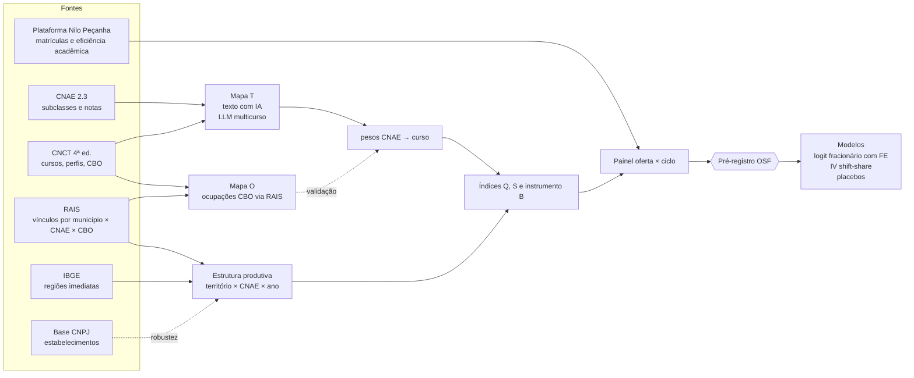

<div align="center">

# Aderência territorial e evasão na EPT

**Aderência territorial, permanência e conclusão na educação profissional técnica da Rede Federal: evidência nacional para cursos presenciais e a distância com inteligência artificial e dados abertos**

TCC · Especialização em EaD na Educação Profissional e Tecnológica · IFSul

[](#status)
[](docs/pre-registro/plano-osf.md)
[](docs/resultados/avaliacao-classificador-t.json)
[](pyproject.toml)
[](https://pandas.pydata.org/)
[](https://duckdb.org/)
[](https://www.statsmodels.org/)
[](https://www.sbert.net/)
[](tests/)
[](https://docs.astral.sh/ruff/)
[-lightgrey?logo=osf)](docs/pre-registro/plano-osf.md)
[](#fontes-de-dados)
[-informational)](docs/spec/06-ciencia-aberta-etica.md)
[](LICENSE)
[](https://creativecommons.org/licenses/by/4.0/)

</div>

---

## Sumário

- [Sobre a pesquisa](#sobre-a-pesquisa)
- [Pergunta e hipóteses](#pergunta-e-hipóteses)
- [Desenho da pesquisa](#desenho-da-pesquisa)
- [Fontes de dados](#fontes-de-dados)
- [Prospecção inicial: o que os dados já mostraram](#prospecção-inicial-o-que-os-dados-já-mostraram)
- [Resultados até agora](#resultados-até-agora)
- [Estrutura do repositório](#estrutura-do-repositório)
- [Instalação e uso](#instalação-e-uso)
- [Documentação](#documentação)
- [Cronograma e marcos](#cronograma-e-marcos)
- [Ciência aberta e ética](#ciência-aberta-e-ética)
- [Status](#status)
- [Como citar](#como-citar)
- [Licença](#licença)

---

## Sobre a pesquisa

A Lei 11.892/2008 determina que os Institutos Federais orientem sua oferta para os **arranjos produtivos locais**. A diretriz é central na identidade da Rede Federal, mas não existe medida sistemática dela nem evidência nacional sobre sua relação com **evasão e conclusão**, menos ainda na **educação a distância**.

A relação também não tem direção óbvia:

- 🟢 **Pertencimento e perspectiva:** um curso ligado à economia local dá sentido à formação e perspectiva de inserção, o que favorece a permanência.
- 🔴 **Custo de oportunidade:** um mercado aquecido no setor do curso puxa o estudante para o emprego antes da conclusão, o que aumenta a evasão.

A pesquisa mede qual mecanismo predomina, em que tipo de curso e em qual modalidade, para **toda a Rede Federal**, usando **apenas dados públicos**.

## Pergunta e hipóteses

> A aderência entre os cursos técnicos da Rede Federal e a estrutura produtiva do seu território está associada à evasão e à conclusão? Em que direção, por qual mecanismo, e essa associação difere entre EaD e presencial?

| Hipótese | Mecanismo | Variável | Sinal esperado (evasão) |
|---|---|---|---|
| **H1a** | Pertencimento | Aderência estrutural `Q` (quociente locacional do emprego ligado ao curso) | negativo |
| **H1b** | Custo de oportunidade | Choque de demanda `S` no setor do curso durante o ciclo | positivo, maior em cursos subsequentes |
| **H2** | Modalidade | Interação `Q × EaD` | efeito de `Q` mais fraco na EaD |

## Desenho da pesquisa



### Mapeamento atividade econômica → curso (dois caminhos independentes)

| Caminho | Como funciona | Papel |
|---|---|---|
| **T — texto com IA** | LLM (ERNIE, via OpenRouter, modelos gratuitos) atribui a cada subclasse CNAE o eixo e todos os cursos do CNCT ligados a ela, com pesos e justificativa; um segundo LLM (Nemotron) mede a concordância. TF-IDF e embeddings são as linhas de base | **Mapa principal** |
| **O — ocupações** | Peso de cada subclasse no curso = fração dos seus vínculos RAIS nas ocupações CBO associadas ao curso pelo CNCT | Validação de convergência e robustez |

Validação contra uma amostra de referência de **300 subclasses** (99 de desenvolvimento, 201 de teste), anotada por LLM na falta de segundo avaliador humano ([ADR-0004](docs/adr/0004-avaliador-unico.md)): precisão, revocação e F1 por eixo, com IC por bootstrap, contra as linhas de base. A validação humana de uma subamostra está pendente.

### Estratégia de identificação

| Análise | O que resolve |
|---|---|
| FE de **campus × ciclo** e **curso × ciclo** (H1a, H2) | Compara o mesmo curso entre campi e cada campus consigo mesmo entre cursos |
| FE de **oferta** e **ano** (H1b) | Usa a variação do choque de demanda dentro da mesma oferta |
| Instrumento **shift-share** (Bartik) | Endogeneidade da demanda local |
| **Placebos** de território e de eixo | Testa se o modelo capta outro fator |
| **Robustez** | Território, mapa (T × O), edição do CNCT, ponderação |
| **Simulação de poder** | Menor efeito detectável, reportado antes do pré-registro |

## Fontes de dados

| Fonte | Conteúdo | Acesso |
|---|---|---|
| [Plataforma Nilo Peçanha](https://www.gov.br/mec/pt-br/pnp) | Microdados de eficiência acadêmica, edições 2018–2023 (versionados em `data/pnp/`) | Download manual (portal com verificação anti-robô) |
| [RAIS](ftp://ftp.mtps.gov.br/pdet/microdados/RAIS/) | Microdados públicos de vínculos; usados 2012–2025 | FTP do MTE |
| Base de CNPJ (Receita Federal) | Estabelecimentos por CNAE e município | Pipeline próprio do pesquisador |
| [CNCT 4ª ed.](https://www.saude.sp.gov.br/resources/crh/gsdrh/supervisao-esc/catalogocursostecnicosatualizadoemnovde2024.pdf) | 214 cursos, 13 eixos, perfis, CBO | PDF consolidado (alterado em 29/11/2024) |
| [CNAE 2.3](https://servicodados.ibge.gov.br/api/v2/cnae/subclasses) | 1.332 subclasses com notas explicativas | API do IBGE |
| [Divisão regional IBGE](https://servicodados.ibge.gov.br/api/v1/localidades/municipios) | 510 regiões imediatas, 133 intermediárias | API do IBGE |

> Os dados brutos, intermediários e processados **não** são versionados (ver `.gitignore`); são reproduzíveis pelo pipeline ([`data/README.md`](data/README.md), [`scripts/README.md`](scripts/README.md)). A PNP em Parquet, as tabelas externas e a amostra de referência são versionadas.

## Prospecção inicial: o que os dados já mostraram

Relatório completo: [`docs/prospeccao/relatorio-viabilidade.md`](docs/prospeccao/relatorio-viabilidade.md).

| Item | Resultado | Veredito |
|---|---|---|
| CNCT | 212 de 214 cursos extraídos; 164 de 189 cursos civis com ocupações CBO; permissão de EaD por curso | ✅ viável |
| CNAE | 1.332 subclasses, todas com notas "compreende / não compreende" | ✅ viável |
| RAIS | Município × subclasse × CBO em todos os anos; ~28 GB (2015–2024), 4–5 h de processamento | ✅ viável |
| IBGE | 100% dos municípios da RAIS casados com regiões imediatas | ✅ viável |
| Ponte CBO | Boa para Enfermagem e Informática; falha em Administração, Agronegócio e Agropecuária | ⚠️ só como validação |
| Variação temporal de `Q` | Correlação 0,93 entre 2019 e 2024; só 3,5% da variância é intra-território | ⚠️ mudou o desenho de H1a |
| Variação do choque `S` | dp ≈ 0,26 em 5 anos | ✅ H1b identificável |
| Plataforma Nilo Peçanha (safra 2022) | 2.641 ofertas técnicas presenciais e 111 EaD; evasão de 40% (presencial) e 50% (EaD); só há o município da unidade | ✅ viável |
| Efeitos fixos cruzados (H1a) | 563/624 campi com ≥ 2 cursos; 107/140 cursos em ≥ 2 campi (99% das matrículas) | ✅ viável |
| Poder para H2 (EaD) | 56% das matrículas EaD em Gestão e Negócios | ⚠️ calcular efeito mínimo detectável |
| Casamento PNP ↔ CNCT | 99,6% das matrículas | ✅ viável |

## Resultados até agora

Página interativa com estes resultados: **https://tccept.brunokobi.tech**

Nenhum efeito foi estimado: os modelos esperam o pré-registro no OSF. O que já está pronto:

**Dados.** RAIS 2012–2025 agregada por região imediata × subclasse CNAE 2.3 (totais iguais aos oficiais, exceto 2019 no DF e em SE, [P16](docs/pendencias.md)). PNP: 22.316 ciclos técnicos iniciados em 2011–2022, 1.855 deles EaD. Verificação completa em [`verificacao-dados-completos.md`](docs/prospeccao/verificacao-dados-completos.md).

**Classificador T (marco G2, avaliação única no teste, 201 subclasses).** Detalhe em [`avaliacao-classificador-t.json`](docs/resultados/avaliacao-classificador-t.json).

| Método | Acurácia | Macro-F1 [IC 95%] |
|---|---|---|
| TF-IDF (linha de base) | 0,52 | 0,46 [0,39; 0,53] |
| Embeddings | 0,52 | 0,47 [0,40; 0,55] |
| Caminho O (CBO) | 0,59 | 0,45 [0,38; 0,53] |
| Nemotron | 0,85 | 0,76 [0,68; 0,81] |
| **T final (ERNIE)** | **0,89** | **0,83 [0,75; 0,88]** |

Alfa de Krippendorff entre os dois LLMs: 0,89. Segunda passada multicurso: 4,7 cursos por subclasse em média, 188 dos 189 cursos civis cobertos ([ADR-0005](docs/adr/0005-indices-q-s-b.md)).

**Índices por ciclo** ([`indices.json`](docs/resultados/indices.json)):
- `Q` definido em **98%** dos ciclos (96% dos EaD);
- convergência entre os caminhos T e O no `Q`: Spearman **0,65**;
- correlação entre o choque `S` e o instrumento Bartik `B`: 0,42;
- sentinela: o `Q` de Agropecuária vai de −1,19 a +1,32 do tercil menos ao mais agrícola.

**Poder (efeito mínimo detectável a 80%, por 1 dp de `Q`):** H1a 1,3 p.p. de evasão; H2 7,5 p.p. (por isso H2 é secundária).

**Revisão sistemática (v1).** OpenAlex, 471 registros, 43 incluídos. Nenhum estudo encontrado mede a aderência curso × território com dados administrativos nacionais e a relaciona à evasão ([síntese](docs/revisao/sintese.md)).

## Estrutura do repositório

```
.
├── docs/
│   ├── INDEX.md                 # mapa da documentação
│   ├── preprojeto/              # pré-projeto v1 (PDF + md) e v2
│   ├── spec/                    # specs 00–06: fonte de verdade da implementação
│   ├── adr/                     # registros de decisão
│   ├── prospeccao/              # relatório de viabilidade dos dados
│   ├── resultados/              # métricas do classificador e dos índices (JSON)
│   ├── pre-registro/            # rascunho OSF e registro de desvios
│   ├── revisao/                 # protocolo, busca, triagem PRISMA, síntese
│   ├── cronograma.md
│   └── pendencias.md
├── src/tcc_aderencia/
│   ├── ingest/                  # CNPJ, RAIS, PNP, CNCT/CNAE, IBGE
│   ├── classifier/              # baseline, embeddings, LLM, avaliação
│   ├── index/                   # índices Q, S e Bartik B
│   ├── models/                  # logit fracionário, painel, shift-share, placebos, poder
│   ├── dashboard/  mcp_server/  chat/   # extensões (produto técnico)
│   └── config.py
├── data/
│   ├── pnp/ external/ reference/  # versionados
│   └── raw/ interim/ processed/   # fora do git
├── annotation/                  # protocolo de anotação
├── notebooks/                   # exploração (não é fonte de verdade)
├── paper/                       # artigo(s)
├── reports/                     # tabelas e figuras geradas
├── scripts/                     # pontos de entrada do pipeline
└── tests/
```

## Instalação e uso

**Requisitos:** Python 3.11 ou superior. Para a RAIS completa, ~30 GB livres para download (processamento arquivo a arquivo).

```bash
git clone https://github.com/brunokobi/tcc_ept.git
cd tcc_ept
python3 -m venv .venv
source .venv/bin/activate
pip install -e ".[dev,llm]"      # extras: dashboard, mcp
pytest                           # testes
ruff check src tests             # lint
```

A etapa LLM usa a variável de ambiente `OPENROUTER_API_KEY` (só modelos gratuitos). A chave nunca vai para o repositório.

### Pipeline

```bash
python -m tcc_aderencia.ingest.rais 2012 2013 ... 2025   # RAIS: baixa e agrega (horas)
python scripts/verify_data.py saida.json               # viabilidade (descritivo)
python scripts/evaluate_test.py                        # avaliação única do classificador T (G2)
python scripts/run_course_weights.py                   # 2ª passada do LLM: pesos multicurso
python scripts/build_indices.py                        # Q, S, B e variantes por ciclo
python scripts/make_figures.py                         # figuras descritivas + dados da página
TCCEPT_SSH_KEY=<chave> scripts/deploy_pagina.sh        # publica em tccept.brunokobi.tech
python scripts/search_literature.py                    # busca da revisão sistemática
```

As etapas anteriores ao `evaluate_test.py` (PNP, caminho O, linhas de base e LLM) rodam pelas funções de `tcc_aderencia.ingest` e `tcc_aderencia.classifier`; ver [`scripts/README.md`](scripts/README.md).

## Documentação

| Documento | Conteúdo |
|---|---|
| [Pré-projeto v2](docs/preprojeto/preprojeto-v2.md) | Versão revisada (mecanismos concorrentes, identificação, referencial) |
| [Pré-projeto v1](docs/preprojeto/preprojeto.md) | Versão original ([PDF](docs/preprojeto/preprojeto-tcc-ead-ept-ifsul.pdf)) |
| [Spec 00](docs/spec/00-visao-geral.md) | Visão geral, hipóteses e pipeline |
| [Spec 01](docs/spec/01-fontes-de-dados.md) | Fontes, chaves de junção e harmonização |
| [Spec 02](docs/spec/02-classificador-cnae-cnct.md) | Mapeamento CNAE → CNCT e validação |
| [Spec 03](docs/spec/03-indice-aderencia.md) | Índices Q, S e instrumento B |
| [Spec 04](docs/spec/04-modelagem-identificacao.md) | Modelos e estratégia de identificação |
| [Spec 05](docs/spec/05-produto-tecnico.md) | Painel, servidor MCP e chat (extensão) |
| [Spec 06](docs/spec/06-ciencia-aberta-etica.md) | Ciência aberta, ética e limitações |
| [ADRs](docs/adr/) | Edição do CNCT, unidade territorial, stack, referência por LLM (0004), definição de Q, S e B (0005) |
| [Pré-registro](docs/pre-registro/plano-osf.md) | Rascunho v2 para o OSF: hipóteses, modelos, inferência, MDE, robustez |
| [Resultados](docs/resultados/) | Avaliação do classificador e índices (JSON) |
| [Revisão sistemática](docs/revisao/sintese.md) | Busca, triagem PRISMA e síntese preliminar |
| [Pendências](docs/pendencias.md) | Pontos a verificar (P1–P21) |
| [Cronograma](docs/cronograma.md) | Etapas, marcos e situação atual |

## Cronograma e marcos

Meses relativos ao início do TCC. **Núcleo** antes de **extensões**.

| Etapa | M1 | M2 | M3 | M4 | M5 | M6 | M7 | M8 | M9 |
|---|---|---|---|---|---|---|---|---|---|
| Revisão sistemática | ■ | ■ | | | | | | | |
| Coleta e harmonização | ■ | ■ | ■ | | | | | | |
| Anotação de referência | | ■ | ■ | ■ | | | | | |
| Mapeamentos e validação | | | ■ | ■ | | | | | |
| Poder + pré-registro OSF | | | | ■ | | | | | |
| Índices e modelos | | | | ■ | ■ | ■ | | | |
| Redação do artigo | | | | | | ■ | ■ | ■ | |
| Extensões | | | | | | ■ | ■ | ■ | |
| Entrega e defesa | | | | | | | | | ■ |

| Marco | Critério |
|---|---|
| **G1** (fim M3) ✅ | Painel oferta × ciclo montado; ofertas EaD e ciclos confirmados |
| **G2** (fim M4) ✅ | Mapa T com macro-F1 acima da linha de base; convergência T × O |
| **G3** (M4) ⏳ | Simulação de poder e pré-registro publicados — **sem G3, nenhum efeito é estimado** |
| **G4** (fim M6) | Resultados principais e robustez fechados → extensões liberadas |

## Ciência aberta e ética

- **Pré-registro no OSF** antes de qualquer estimação de efeito; desvios documentados em [`docs/pre-registro/desvios.md`](docs/pre-registro/desvios.md).
- **Resultados reportados como vierem**, inclusive nulos ou contrários às hipóteses.
- **Publicação com DOI no Zenodo:** código, dados derivados agregados e o mapeamento CNAE → CNCT.
- **Ética:** apenas dados públicos, anonimizados na origem e analisados de forma agregada, sem participação de pessoas — dispensa de apreciação pelo sistema CEP/Conep (Resolução CNS 510/2016).

## Status

- [x] Estrutura do projeto, specs e ADRs
- [x] Pré-projeto v2
- [x] Prospecção e verificação de viabilidade com todos os dados
- [x] Ingestão: PNP 2018–2023 e RAIS 2012–2025
- [x] Amostra de referência anotada (por LLM, ADR-0004)
- [x] Classificador T avaliado no teste (G2) e caminho O
- [x] Índices Q, S e B por ciclo
- [x] Simulação de poder com o Q real
- [ ] Revisão sistemática: v1 feita (OpenAlex); faltam bases manuais, bola de neve e leitura completa
- [ ] Validação humana de uma subamostra da referência (P12)
- [ ] Conferir a correspondência CNAE com as tabelas do IBGE (P21)
- [ ] Aprovação do orientador (ADR-0004, ADR-0005, edição do CNCT) e pré-registro no OSF
- [ ] Modelos e resultados
- [ ] Artigo

## Como citar

```bibtex
@misc{kobi_aderencia_ept,
  author       = {Kobi, Bruno},
  title        = {Aderência territorial, permanência e conclusão na educação profissional técnica da Rede Federal},
  year         = {2026},
  howpublished = {\url{https://github.com/brunokobi/tcc_ept}},
  note         = {Trabalho de Conclusão de Curso, IFSul}
}
```

## Licença

- **Código:** [MIT](LICENSE)
- **Dados derivados e mapeamento CNAE → CNCT:** [CC BY 4.0](https://creativecommons.org/licenses/by/4.0/)
