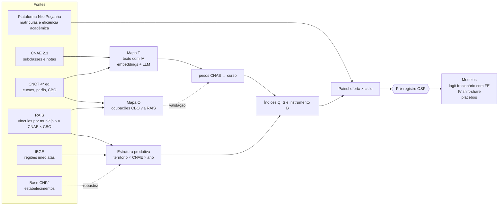

<div align="center">

# Aderência territorial e evasão na EPT

**Aderência territorial, permanência e conclusão na educação profissional técnica da Rede Federal: evidência nacional para cursos presenciais e a distância com inteligência artificial e dados abertos**

TCC · Especialização em EaD na Educação Profissional e Tecnológica · IFSul

[](#status)
[](docs/prospeccao/relatorio-viabilidade.md)
[](pyproject.toml)
[](https://pandas.pydata.org/)
[](https://duckdb.org/)
[](https://www.statsmodels.org/)
[](https://www.sbert.net/)
[](tests/)
[](https://docs.astral.sh/ruff/)
[-lightgrey?logo=osf)](docs/pre-registro/plano-osf.md)
[](#fontes-de-dados)
[-informational)](docs/spec/06-ciencia-aberta-etica.md)
[](LICENSE)
[](https://creativecommons.org/licenses/by/4.0/)

</div>

---

## Sumário

- [Sobre a pesquisa](#sobre-a-pesquisa)
- [Pergunta e hipóteses](#pergunta-e-hipóteses)
- [Desenho da pesquisa](#desenho-da-pesquisa)
- [Fontes de dados](#fontes-de-dados)
- [Prospecção inicial: o que os dados já mostraram](#prospecção-inicial-o-que-os-dados-já-mostraram)
- [Estrutura do repositório](#estrutura-do-repositório)
- [Instalação e uso](#instalação-e-uso)
- [Documentação](#documentação)
- [Cronograma e marcos](#cronograma-e-marcos)
- [Ciência aberta e ética](#ciência-aberta-e-ética)
- [Status](#status)
- [Como citar](#como-citar)
- [Licença](#licença)

---

## Sobre a pesquisa

A Lei 11.892/2008 determina que os Institutos Federais orientem sua oferta para os **arranjos produtivos locais**. A diretriz é central na identidade da Rede Federal, mas não existe medida sistemática dela nem evidência nacional sobre sua relação com **evasão e conclusão**, menos ainda na **educação a distância**.

A relação também não tem direção óbvia:

- 🟢 **Pertencimento e perspectiva:** um curso ligado à economia local dá sentido à formação e perspectiva de inserção, o que favorece a permanência.
- 🔴 **Custo de oportunidade:** um mercado aquecido no setor do curso puxa o estudante para o emprego antes da conclusão, o que aumenta a evasão.

A pesquisa mede qual mecanismo predomina, em que tipo de curso e em qual modalidade, para **toda a Rede Federal**, usando **apenas dados públicos**.

## Pergunta e hipóteses

> A aderência entre os cursos técnicos da Rede Federal e a estrutura produtiva do seu território está associada à evasão e à conclusão? Em que direção, por qual mecanismo, e essa associação difere entre EaD e presencial?

| Hipótese | Mecanismo | Variável | Sinal esperado (evasão) |
|---|---|---|---|
| **H1a** | Pertencimento | Aderência estrutural `Q` (quociente locacional do emprego ligado ao curso) | negativo |
| **H1b** | Custo de oportunidade | Choque de demanda `S` no setor do curso durante o ciclo | positivo, maior em cursos subsequentes |
| **H2** | Modalidade | Interação `Q × EaD` | efeito de `Q` mais fraco na EaD |

## Desenho da pesquisa



### Mapeamento atividade econômica → curso (dois caminhos independentes)

| Caminho | Como funciona | Papel |
|---|---|---|
| **T — texto com IA** | Embeddings das descrições e notas CNAE e dos perfis e campos de atuação do CNCT; LLM (2 provedores) para casos ambíguos, com justificativa registrada | **Mapa principal** |
| **O — ocupações** | Peso de cada subclasse no curso = fração dos seus vínculos RAIS nas ocupações CBO associadas ao curso pelo CNCT | Validação de convergência e robustez |

Validação contra amostra de cerca de **300 subclasses anotadas por dois avaliadores** (concordância inter e intra-avaliador por alfa de Krippendorff), com precisão, revocação e F1 por eixo e comparação com uma linha de base por palavras-chave.

### Estratégia de identificação

| Análise | O que resolve |
|---|---|
| FE de **campus × ciclo** e **curso × ciclo** (H1a, H2) | Compara o mesmo curso entre campi e cada campus consigo mesmo entre cursos |
| FE de **oferta** e **ano** (H1b) | Usa a variação do choque de demanda dentro da mesma oferta |
| Instrumento **shift-share** (Bartik) | Endogeneidade da demanda local |
| **Placebos** de território e de eixo | Testa se o modelo capta outro fator |
| **Robustez** | Território, mapa (T × O), edição do CNCT, ponderação |
| **Simulação de poder** | Menor efeito detectável, reportado antes do pré-registro |

## Fontes de dados

| Fonte | Conteúdo | Acesso |
|---|---|---|
| [Plataforma Nilo Peçanha](https://www.gov.br/mec/pt-br/pnp) | Microdados de matrículas e eficiência acadêmica | Download manual (portal com verificação anti-robô) |
| [RAIS](ftp://ftp.mtps.gov.br/pdet/microdados/RAIS/) | Microdados públicos de vínculos, 1985–2025 | FTP do MTE |
| Base de CNPJ (Receita Federal) | Estabelecimentos por CNAE e município | Pipeline próprio do pesquisador |
| [CNCT 4ª ed.](https://www.saude.sp.gov.br/resources/crh/gsdrh/supervisao-esc/catalogocursostecnicosatualizadoemnovde2024.pdf) | 214 cursos, 13 eixos, perfis, CBO | PDF consolidado (alterado em 29/11/2024) |
| [CNAE 2.3](https://servicodados.ibge.gov.br/api/v2/cnae/subclasses) | 1.332 subclasses com notas explicativas | API do IBGE |
| [Divisão regional IBGE](https://servicodados.ibge.gov.br/api/v1/localidades/municipios) | 510 regiões imediatas, 133 intermediárias | API do IBGE |

> Os dados brutos e intermediários **não** são versionados (ver `.gitignore`); são reproduzíveis pelos módulos de `src/tcc_aderencia/ingest/`. A amostra de referência anotada (`data/reference/`) é versionada.

## Prospecção inicial: o que os dados já mostraram

Relatório completo: [`docs/prospeccao/relatorio-viabilidade.md`](docs/prospeccao/relatorio-viabilidade.md).

| Item | Resultado | Veredito |
|---|---|---|
| CNCT | 212 de 214 cursos extraídos; 164 de 189 cursos civis com ocupações CBO; permissão de EaD por curso | ✅ viável |
| CNAE | 1.332 subclasses, todas com notas "compreende / não compreende" | ✅ viável |
| RAIS | Município × subclasse × CBO em todos os anos; ~28 GB (2015–2024), 4–5 h de processamento | ✅ viável |
| IBGE | 100% dos municípios da RAIS casados com regiões imediatas | ✅ viável |
| Ponte CBO | Boa para Enfermagem e Informática; falha em Administração, Agronegócio e Agropecuária | ⚠️ só como validação |
| Variação temporal de `Q` | Correlação 0,93 entre 2019 e 2024; só 3,5% da variância é intra-território | ⚠️ mudou o desenho de H1a |
| Variação do choque `S` | dp ≈ 0,26 em 5 anos | ✅ H1b identificável |
| Plataforma Nilo Peçanha (safra 2022) | 2.641 ofertas técnicas presenciais e 111 EaD; evasão de 40% (presencial) e 50% (EaD); só há o município da unidade | ✅ viável |
| Efeitos fixos cruzados (H1a) | 563/624 campi com ≥ 2 cursos; 107/140 cursos em ≥ 2 campi (99% das matrículas) | ✅ viável |
| Poder para H2 (EaD) | 56% das matrículas EaD em Gestão e Negócios | ⚠️ calcular efeito mínimo detectável |
| Casamento PNP ↔ CNCT | 99,6% das matrículas | ✅ viável |

## Estrutura do repositório

```
.
├── docs/
│   ├── INDEX.md                 # mapa da documentação
│   ├── preprojeto/              # pré-projeto v1 (PDF + md) e v2
│   ├── spec/                    # specs 00–06: fonte de verdade da implementação
│   ├── adr/                     # registros de decisão
│   ├── prospeccao/              # relatório de viabilidade dos dados
│   ├── pre-registro/            # rascunho OSF e registro de desvios
│   ├── revisao/                 # protocolo PRISMA, triagem, referências
│   ├── cronograma.md
│   └── pendencias.md
├── src/tcc_aderencia/
│   ├── ingest/                  # CNPJ, RAIS, PNP, CNCT/CNAE, IBGE
│   ├── classifier/              # baseline, embeddings, LLM, avaliação
│   ├── index/                   # índices de aderência (Q, QL, S)
│   ├── models/                  # logit fracionário, painel, shift-share, placebos, poder
│   ├── dashboard/  mcp_server/  chat/   # extensões (produto técnico)
│   └── config.py
├── data/
│   ├── raw/ interim/ processed/ external/   # fora do git
│   └── reference/               # amostra de referência anotada (versionada)
├── annotation/                  # protocolo de anotação
├── notebooks/                   # exploração (não é fonte de verdade)
├── paper/                       # artigo(s)
├── reports/                     # tabelas e figuras geradas
├── scripts/                     # pontos de entrada do pipeline
└── tests/
```

## Instalação e uso

**Requisitos:** Python 3.11 ou superior. Para a RAIS completa, ~30 GB livres para download (processamento arquivo a arquivo).

```bash
git clone https://github.com/brunokobi/tcc_ept.git
cd tcc_ept
python3 -m venv .venv
source .venv/bin/activate
pip install -e ".[dev,llm]"      # extras: dashboard, mcp
cp .env.example .env             # chaves de API dos LLMs
pytest                           # testes
ruff check src tests             # lint
```

### Exemplos

```python
from pathlib import Path
from tcc_aderencia.ingest.cnct import load_cnct, load_cnae_subclasses

cursos = load_cnct(Path("cnct4.pdf"))   # uma linha por curso, com eixo, perfil, CBO e EaD
cnae = load_cnae_subclasses()           # 1.332 subclasses via API do IBGE
```

```python
from tcc_aderencia.index.aderencia import axis_employment_share, location_quotient

shares = axis_employment_share(employment, mapping)        # participação no emprego
ql = location_quotient(shares, employment, mapping)        # quociente locacional
```

## Documentação

| Documento | Conteúdo |
|---|---|
| [Pré-projeto v2](docs/preprojeto/preprojeto-v2.md) | Versão revisada (mecanismos concorrentes, identificação, referencial) |
| [Pré-projeto v1](docs/preprojeto/preprojeto.md) | Versão original ([PDF](docs/preprojeto/preprojeto-tcc-ead-ept-ifsul.pdf)) |
| [Spec 00](docs/spec/00-visao-geral.md) | Visão geral, hipóteses e pipeline |
| [Spec 01](docs/spec/01-fontes-de-dados.md) | Fontes, chaves de junção e harmonização |
| [Spec 02](docs/spec/02-classificador-cnae-cnct.md) | Mapeamento CNAE → CNCT e validação |
| [Spec 03](docs/spec/03-indice-aderencia.md) | Índices Q, S e instrumento B |
| [Spec 04](docs/spec/04-modelagem-identificacao.md) | Modelos e estratégia de identificação |
| [Spec 05](docs/spec/05-produto-tecnico.md) | Painel, servidor MCP e chat (extensão) |
| [Spec 06](docs/spec/06-ciencia-aberta-etica.md) | Ciência aberta, ética e limitações |
| [ADRs](docs/adr/) | Edição do CNCT, unidade territorial, stack |
| [Pendências](docs/pendencias.md) | Pontos a verificar (P1–P13) |

## Cronograma e marcos

Meses relativos ao início do TCC. **Núcleo** antes de **extensões**.

| Etapa | M1 | M2 | M3 | M4 | M5 | M6 | M7 | M8 | M9 |
|---|---|---|---|---|---|---|---|---|---|
| Revisão sistemática | ■ | ■ | | | | | | | |
| Coleta e harmonização | ■ | ■ | ■ | | | | | | |
| Anotação de referência | | ■ | ■ | ■ | | | | | |
| Mapeamentos e validação | | | ■ | ■ | | | | | |
| Poder + pré-registro OSF | | | | ■ | | | | | |
| Índices e modelos | | | | ■ | ■ | ■ | | | |
| Redação do artigo | | | | | | ■ | ■ | ■ | |
| Extensões | | | | | | ■ | ■ | ■ | |
| Entrega e defesa | | | | | | | | | ■ |

| Marco | Critério |
|---|---|
| **G1** (fim M3) | Painel oferta × ciclo montado; ofertas EaD e ciclos confirmados |
| **G2** (fim M4) | Mapa T com macro-F1 acima da linha de base; convergência T × O |
| **G3** (M4) | Simulação de poder e pré-registro publicados — **sem G3, nenhum efeito é estimado** |
| **G4** (fim M6) | Resultados principais e robustez fechados → extensões liberadas |

## Ciência aberta e ética

- **Pré-registro no OSF** antes de qualquer estimação de efeito; desvios documentados em [`docs/pre-registro/desvios.md`](docs/pre-registro/desvios.md).
- **Resultados reportados como vierem**, inclusive nulos ou contrários às hipóteses.
- **Publicação com DOI no Zenodo:** código, dados derivados agregados e o mapeamento CNAE → CNCT.
- **Ética:** apenas dados públicos, anonimizados na origem e analisados de forma agregada, sem participação de pessoas — dispensa de apreciação pelo sistema CEP/Conep (Resolução CNS 510/2016).

## Status

- [x] Estrutura do projeto, specs e ADRs
- [x] Pré-projeto v2
- [x] Prospecção: CNCT, CNAE, IBGE, RAIS (amostra)
- [x] Prospecção: Plataforma Nilo Peçanha (safra 2022)
- [ ] Download das demais safras da PNP (2018–2025)
- [ ] Revisão sistemática
- [ ] Ingestão completa (RAIS 2015–2024, PNP)
- [ ] Amostra de referência anotada
- [ ] Mapeamentos T e O validados
- [ ] Pré-registro no OSF
- [ ] Modelos e resultados
- [ ] Artigo

## Como citar

```bibtex
@misc{kobi_aderencia_ept,
  author       = {Kobi, Bruno},
  title        = {Aderência territorial, permanência e conclusão na educação profissional técnica da Rede Federal},
  year         = {2026},
  howpublished = {\url{https://github.com/brunokobi/tcc_ept}},
  note         = {Trabalho de Conclusão de Curso, IFSul}
}
```

## Licença

- **Código:** [MIT](LICENSE)
- **Dados derivados e mapeamento CNAE → CNCT:** [CC BY 4.0](https://creativecommons.org/licenses/by/4.0/)
